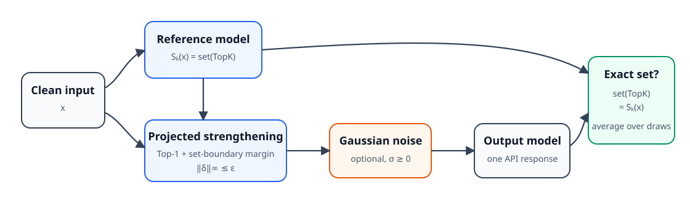

# Clean-Reference Top-k Fidelity

Code and protocol snapshot for studying **exact unordered Top-k set fidelity**
under adversarial queries. The repository contains a compact reusable package,
audited query-accounting utilities, and the frozen experiment programs used for
CIFAR-10, CIFAR-100, ImageNet, and the ongoing cross-architecture ViT study.

> **Double-blind review notice.** This copy is intentionally anonymized. Do not
> add author names, personal URLs, identifying badges, or a public personal
> fork while the work is under review. See
> [docs/ANONYMOUS_ARTIFACT.md](docs/ANONYMOUS_ARTIFACT.md).



## Research question

For a clean input \(x\), let a reference model define an unordered set
\(S_k(x)\) of its Top-k classes. For a defended model \(f_D\), we measure the
probability that an independently sampled defended response on a possibly
attacked input \(x'\) returns exactly that set:

\[
\Pr_\omega\!\left[\operatorname{set}(\operatorname{TopK}(f_D(x';\omega),k))
= S_k(x)\right].
\]

The primary protocol evaluates each stochastic response separately. Averaging
logits before computing the set is a secondary diagnostic, not the primary
metric. Every constituent stochastic draw is charged as one API query.

## Repository map

| Path | Purpose |
|---|---|
| `src/topk_fidelity/` | Small, documented implementation of the wrapper, metrics, and query accounting |
| `experiments/frozen/` | Sanitized protocol snapshot of the experiment, launcher, re-evaluation, finalization, and audit scripts |
| `tests/` | CPU unit tests for the reusable package |
| `results/` | Small manuscript-facing result tables; no large tensors or checkpoints |
| `docs/REPRODUCIBILITY.md` | Data layout, stages, and reproduction checklist |
| `docs/GITHUB_PUBLISHING_FA.md` | Persian GitHub publication guide |

Large datasets, model checkpoints, attack candidates, and generated outputs are
excluded from version control.

## Install

Python 3.10+ is recommended. Create an isolated environment, install a PyTorch
build appropriate for your machine, and then install this repository:

```bash
python -m venv .venv
source .venv/bin/activate
python -m pip install --upgrade pip
python -m pip install -e ".[test]"
```

For the frozen end-to-end programs, also install the experiment extras:

```bash
python -m pip install -e ".[experiments,test]"
```

PyTorch/CUDA wheels are platform-specific. For GPU runs, install the matching
PyTorch build first, following the official PyTorch selector.

## Minimal use

```python
from topk_fidelity import CleanReferenceTopKDefense, DefenseConfig

config = DefenseConfig(
    top_k=2,
    steps=2,
    epsilon=0.03,
    alpha=0.005,
    sigma=0.02144277648925781,
    top1_weight=1.0,
    set_weight=4.0,
)

defense = CleanReferenceTopKDefense(
    standard_model=reference_model,
    gradient_model=robust_model,
    output_model=robust_model,
    config=config,
)
draw_logits = defense.draw_logits(images, draws=1000)
```

See [examples/minimal_wrapper.py](examples/minimal_wrapper.py) for a complete
toy example.

## Frozen protocol

The confirmatory settings currently represented in the snapshot are:

| Dataset | k | Attack radius | Confirmatory budget | MC re-evaluation |
|---|---:|---:|---:|---:|
| CIFAR-10 | 2 | 2/255 | 5,000 queries | 1,000 draws |
| CIFAR-100 | 2 | 2/255 | 5,000 queries | 1,000 draws |
| ImageNet / ResNet reference | 5 | 4/255 | 5,000 queries | 1,000 draws |
| ImageNet / ViT reference | 5 | 4/255 | frozen VR4 protocol | pending completion |

Three attack seeds and paired uncertainty estimates are used in the
confirmatory analyses. Pilot search and confirmatory evaluation are separated;
the confirmatory split is not used to tune the defense or attack.

The experiment scripts preserve their stage labels (`R0`--`R7` and
`VR1`--`VR4`) because later programs verify parent artifacts and source hashes.
Start with [experiments/frozen/README.md](experiments/frozen/README.md) rather
than executing an arbitrary launcher.

## Verification

```bash
python -m compileall -q src experiments/frozen tests
python scripts/audit_release.py
pytest -q
sha256sum -c MANIFEST.sha256
```

CI runs the same release audit and unit tests on every push. Dataset-backed
experiments are intentionally not run in CI. `MANIFEST.sha256` identifies the
exact files in this public snapshot.

## Current result snapshot

The existing ResNet-reference confirmatory values are recorded in
[results/paper_summary.csv](results/paper_summary.csv). The ViT-reference
confirmatory branch is marked **pending** and must not be presented as a final
result until its VR4 audit succeeds.

## Citation and license

During double-blind review, `CITATION.cff.template` deliberately contains no
identifying author information. After the review decision, fill it, rename it
to `CITATION.cff`, and tag the exact artifact version.

Original code in this repository is released under the [MIT License](LICENSE).
Adapted Square-attack components retain their upstream BSD 3-Clause notice in
[THIRD_PARTY_NOTICES.md](THIRD_PARTY_NOTICES.md). Dataset and pretrained-model
licenses remain with their respective owners.
